<div align="center">

<h1 id="koishi-plugin-adapter-napuketto">
  <picture>
    <source media="(prefers-color-scheme: dark)" srcset=".github/assets/wordmark-dark.svg">
    
  </picture>
</h1>

**NapukettoQQ 的 Koishi 适配器 —— 零外部协议端，让 Koishi 直接驱动 QQ NT**

[](https://www.npmjs.com/package/koishi-plugin-adapter-napuketto)
&emsp;
[](https://github.com/NapukettoDev/Adapter-Koishi/actions/workflows/ci.yml)
&emsp;

&emsp;
[](./LICENSE)

<p>
  <a href="#工作原理">工作原理</a> •
  <a href="./docs/README.md">文档</a>
</p>

</div>

---

## 核心特性

- **原生直连**：\
　复用 NapukettoQQ `wrapper.node` 直调 NAPI，MIT 许可，无需独立协议端或 WebUI。
- **隔离自愈**：\
　单账号独立宿主子进程，支持心跳监测与崩溃指数退避重启，不拖垮主进程。
- **双向桥接**：\
　完整映射群 / 私聊 `Session` 元素（文本/@/图/表/音/引）与 Koishi 标准动作 API。
- **便捷登录**：\
　历史票据快速登录，配合 `@koishijs/plugin-console` 支持控制台实时扫码与重登。

---

## 快速开始

### 环境准备

* **Koishi** `^4.18.7`
* **QQ NT 客户端**：Windows 原生；Linux 可通过 WSL / Wine 运行。
* 无需安装或手动启动任何外部协议端——宿主子进程由插件自动编排。

### 安装

```bash
npm install koishi-plugin-adapter-napuketto
# 或使用 pnpm add / yarn add koishi-plugin-adapter-napuketto
```

> [!TIP]
> `@napuketto/*` 依赖、自建宿主入口与 `stub QQNT.dll` 随包分发，安装后无需额外配置。

### 配置

插件本身留空即可，账号配置挂在 `bots` 下（平台名 `onebot`）：

```yaml
plugins:
  adapter-napuketto: {}

bots:
  # 推荐：key 带 QQ 号，天然支持多账号
  onebot:123456789:
    selfId: "123456789"

  # 单账号也可省略 key 后缀：
  # onebot:
  #   selfId: "123456789"
```

`selfId` 是唯一必填项，用于登录、数据目录隔离与票据缓存。

| 配置项 | 类型 | 默认值 | 说明 |
| :--- | :--- | :--- | :--- |
| `selfId` | `string` | **必填** | 登录 QQ 号，用于数据隔离与票据缓存 |
| `qqPath` | `string` | 自动探测 | QQ NT 安装路径 |
| `dataDir` | `string` | 自动解析 | 数据与缓存根目录 |
| `logLevel` | `string` | `debug` | `debug` / `info` / `error` / `silent` |

<details>
<summary><b>更多配置</b>（心跳、重启退避、OB11 动作面、入口覆盖）</summary>

完整配置项、默认值与多账号说明见 [配置文档](./docs/guides/configuration.md)。

</details>

### 登录与收发

启动 Koishi 后，插件会为每个 bot 拉起独立子进程并尝试快速登录；失败时自动进入二维码登录。安装 `@koishijs/plugin-console` 后，可在「插件详情页」扫码，状态实时同步，也支持刷新二维码与重新登录。

登录就绪后即可用标准 Koishi API 收发消息，像这样：

```ts
ctx.on('message', (session) => {
  if (session.content === 'ping') {
    return session.send('pong')
  }
})
```

---

## 工作原理

每个账号一个自建宿主子进程，Koishi 主进程通过 stdin / stdout 的 JSON Lines 与 kernel 通信。原生层的崩溃、卡死由心跳探针与指数退避隔离在子进程内，主进程不受影响。

<details>
<summary><b>展开查看架构图</b></summary>

<picture>
  <source media="(prefers-color-scheme: dark)" srcset=".github/assets/architecture-dark.svg">
  
</picture>

</details>

---

## 参与开发

本仓库独立维护（独立 lockfile / CI），直接依赖 npm 上已发布的 `@napuketto/*`，不进上游 NapukettoQQ 仓的 workspace。

```bash
pnpm install
pnpm check       # Biome + tsc
pnpm test        # Vitest
pnpm build       # tsdown → lib/index.cjs
pnpm build:client
```

* **发布形态**：`lib/index.cjs`（CJS 入口）；`@napuketto/*` 与 koishi 生态按 external 处理，由 npm 安装提供；控制台前端单独构建到 `dist/`。
* **源码开发**：`exports.development` 指向 `src/index.ts`（仅仓库内有效，发布包不含 `src`）；Koishi 以 `require()` 加载时通常走 `lib/index.cjs`，联调前先 `pnpm build`。
* **本地联调**：`pnpm pack` 出 tarball 后 `pnpm add file:<tarball>`，验证完切回 registry 版本；不要用 workspace link。

> [!NOTE]
> `pnpm lint:client`（ESLint 检查 `.vue`）暂不可用：`@typescript-eslint/parser` 尚不支持 TypeScript 7；它不在 `pnpm check` 内。

---

## 生态与导航

* **文档**：[文档索引](./docs/README.md) ｜ [架构总览](./docs/architecture/overview.md) ｜ [配置](./docs/guides/configuration.md) ｜ [排障](./docs/guides/troubleshooting.md) ｜ [发布流程](./docs/operations/release.md) ｜ [更新日志](./CHANGELOG.md)
* **上游**：[NapukettoQQ 主仓](https://github.com/NapukettoDev/NapukettoQQ) ｜ [架构书](https://github.com/NapukettoDev/NapukettoQQ/blob/main/docs/architecture.md)

<!-- -->

> [!CAUTION]
> **免责声明**：\
> 　本项目是 [NapukettoQQ](https://github.com/NapukettoDev/NapukettoQQ) 生态的 Koishi 适配器，代码均为独立自研实现\
> 　与腾讯、QQ 及 Koishi 官方组织无隶属、合作或授权关系\
> 　仅供学习与技术研究，请遵守《QQ 用户协议》及适用法律；基于 [MIT](./LICENSE) 分发

---

## English

`koishi-plugin-adapter-napuketto` is the [Koishi](https://koishi.chat) adapter for [NapukettoQQ](https://github.com/NapukettoDev/NapukettoQQ). Each QQ account runs in a dedicated self-hosted Node.js child process; kernel events are bridged to Koishi sessions and Koishi actions to kernel API calls — no external WebUI or separate protocol server required.

```bash
npm install koishi-plugin-adapter-napuketto
```

*Not affiliated with Tencent, QQ, or the Koishi organization. Entirely original implementation, released under the [MIT License](./LICENSE).*
