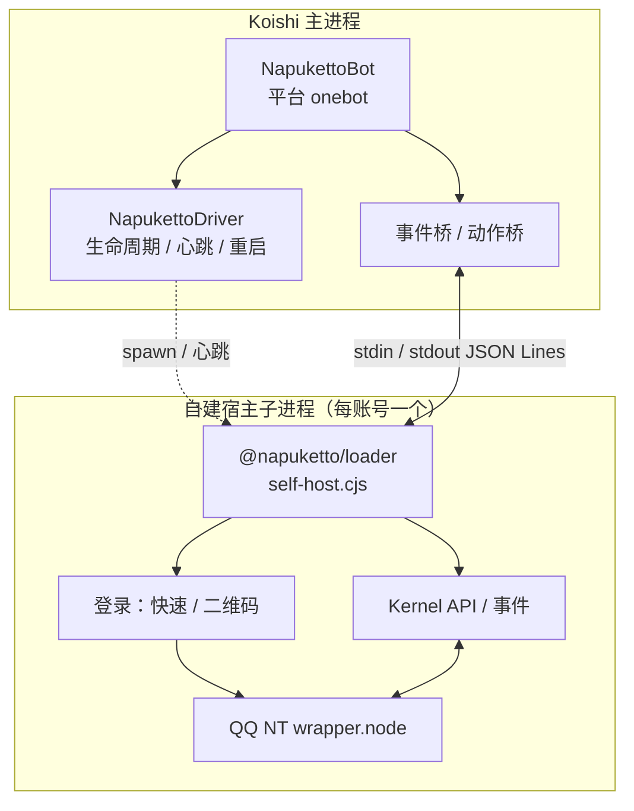

<div align="center">

<h1 id="koishi-plugin-adapter-napuketto">
  <picture>
    <source media="(prefers-color-scheme: dark)" srcset=".github/assets/wordmark-dark.svg">
    
  </picture>
</h1>

**NapukettoQQ 的 Koishi 适配器 —— 零外部协议端，让 Koishi 直接驱动 QQ NT**

[](https://www.npmjs.com/package/koishi-plugin-adapter-napuketto)
&emsp;
[](https://www.npmjs.com/package/koishi-plugin-adapter-napuketto)
&emsp;
[](https://github.com/NapukettoDev/Adapter-Koishi/actions/workflows/ci.yml)
&emsp;

&emsp;
[](./LICENSE)

<p>
  <a href="#核心特性">核心特性</a> •
  <a href="#快速开始">快速开始</a> •
  <a href="#工作原理">工作原理</a> •
  <a href="./docs/design.md">设计文档</a> •
  <a href="#english">English</a>
</p>

</div>

---

## 核心特性

* **自研协议层**\
　复用 NapukettoQQ 的 QQ NT `wrapper.node` 协议层，直接调用官方 NAPI，无中间代理。
* **零外部协议端**\
　MIT 许可；无需额外部署 WebUI 或独立协议端，安装即用。
* **子进程隔离**\
　每个账号独享自建宿主子进程，原生层崩溃自动拉起，不拖垮 Koishi。
* **快速登录 + 心跳自愈**\
　历史票据优先，失败回退二维码；心跳超时按指数退避重启。

<!-- -->

* **事件桥**\
　群聊 / 私聊 / 临时会话 → Koishi `Session`，映射文本、@、图片、表情、语音、引用。
* **动作桥**\
　消息收发、撤回、历史记录、好友 / 群列表、登录信息等标准动作。
* **控制台扫码**\
　集成 `@koishijs/plugin-console`，二维码实时渲染、状态推送、刷新与重新登录。

---

## 快速开始

### 环境准备

* **Koishi** `^4.18.7`
* **QQ NT 客户端**：Windows 原生；Linux 可通过 WSL / Wine 运行。
* 无需安装或手动启动任何外部协议端——宿主子进程由插件自动编排。

### 安装

```bash
npm install koishi-plugin-adapter-napuketto
# 或使用 pnpm add / yarn add koishi-plugin-adapter-napuketto
```

> [!TIP]
> `@napuketto/*` 依赖、自建宿主入口与 `stub QQNT.dll` 随包分发，安装后无需额外配置。

### 配置

插件本身留空即可，账号配置挂在 `bots` 下（平台名 `onebot`）：

```yaml
plugins:
  adapter-napuketto: {}

bots:
  # 推荐：key 带 QQ 号，天然支持多账号
  onebot:3567141148:
    selfId: "3567141148"

  # 单账号也可省略 key 后缀：
  # onebot:
  #   selfId: "3567141148"
```

`selfId` 是唯一必填项，用于登录、数据目录隔离与票据缓存。

| 配置项 | 类型 | 默认值 | 说明 |
| :--- | :--- | :--- | :--- |
| `selfId` | `string` | **必填** | 登录 QQ 号，用于数据隔离与票据缓存 |
| `qqPath` | `string` | 自动探测 | QQ NT 安装路径 |
| `dataDir` | `string` | 自动解析 | 数据与缓存根目录 |
| `logLevel` | `string` | `debug` | `debug` / `info` / `error` / `silent` |

<details>
<summary><b>高级与容灾配置</b>（通常保持默认）</summary>

| 配置项 | 类型 | 默认值 | 说明 |
| :--- | :--- | :--- | :--- |
| `heartbeatTimeoutMs` | `number` | `45000` | 心跳超时（毫秒） |
| `restart.maxRetries` | `number` | `3` | 崩溃最大重启次数（0 = 禁用） |
| `restart.backoffMs` | `number` | `1000` | 首次退避基数（毫秒） |
| `restart.backoffFactor` | `number` | `2` | 退避乘数 |
| `stubDir` | `string` | 包内默认 | stub QQNT.dll 目录覆盖 |
| `kernelEntry` | `string` | 自动解析 | kernel 入口覆盖 |
| `selfHostEntry` | `string` | 包内默认 | 自建宿主入口覆盖 |

</details>

### 登录与收发

启动 Koishi 后，插件会为每个 bot 拉起独立子进程并尝试快速登录；失败时自动进入二维码登录。安装 `@koishijs/plugin-console` 后，可在「插件详情页」扫码，状态实时同步，也支持刷新二维码与重新登录。

登录就绪后即可用标准 Koishi API 收发消息：

```ts
ctx.on('message', (session) => {
  if (session.content === 'ping') {
    return session.send('pong')
  }
})
```

---

## 工作原理

每个账号一个自建宿主子进程，Koishi 主进程通过 stdin / stdout 的 JSON Lines 与 kernel 通信。原生层的崩溃、卡死由心跳探针与指数退避隔离在子进程内，主进程不受影响。



---

## 参与开发

本仓库独立维护（独立 lockfile / CI），直接依赖 npm 上已发布的 `@napuketto/*`，不进主仓 workspace。

```bash
pnpm install
pnpm check       # Biome + tsc
pnpm test        # Vitest
pnpm build       # tsdown → lib/index.cjs
pnpm build:client
```

* **发布形态**：`lib/index.cjs` 单文件 bundle，运行时仅依赖 `koishi`（peer）。
* **开发免构建**：`NODE_ENV=development` 时经 `exports.development` 直载 `src/index.ts`。
* **本地联调**：主仓 `pnpm pack` 出 tarball 后 `pnpm add file:<tarball>`，验证完切回正式版；不要用 workspace link。

> [!NOTE]
> `pnpm lint:client`（ESLint 检查 `.vue`）暂不可用：`@typescript-eslint/parser` 尚不支持 TypeScript 7，待上游兼容后恢复。

---

## 生态与导航

* **文档**：[设计说明](./docs/design.md) ｜ [发布流程](./docs/release.md) ｜ [更新日志](./CHANGELOG.md)
* **上游**：[NapukettoQQ 主仓](https://github.com/NapukettoDev/NapukettoQQ) ｜ [架构书](https://github.com/NapukettoDev/NapukettoQQ/blob/main/docs/architecture.md)
* **反馈**：[GitHub Issues](https://github.com/NapukettoDev/Adapter-Koishi/issues)

> [!CAUTION]
> **免责声明**：\
> 　本项目是 [NapukettoQQ](https://github.com/NapukettoDev/NapukettoQQ) 生态的 Koishi 适配器，代码均为独立自研实现\
> 　与腾讯、QQ 及 Koishi 官方组织无隶属、合作或授权关系\
> 　仅供学习与技术研究，请遵守《QQ 用户协议》及适用法律；基于 [MIT](./LICENSE) 分发

---

## English

`koishi-plugin-adapter-napuketto` is the [Koishi](https://koishi.chat) adapter for [NapukettoQQ](https://github.com/NapukettoDev/NapukettoQQ). Each QQ account runs in a dedicated self-hosted Node.js child process; kernel events are bridged to Koishi sessions and Koishi actions to kernel API calls — no external WebUI or separate protocol server required.

```bash
npm install koishi-plugin-adapter-napuketto
```

*Not affiliated with Tencent, QQ, or the Koishi organization. Entirely original implementation, released under the [MIT License](./LICENSE).*
